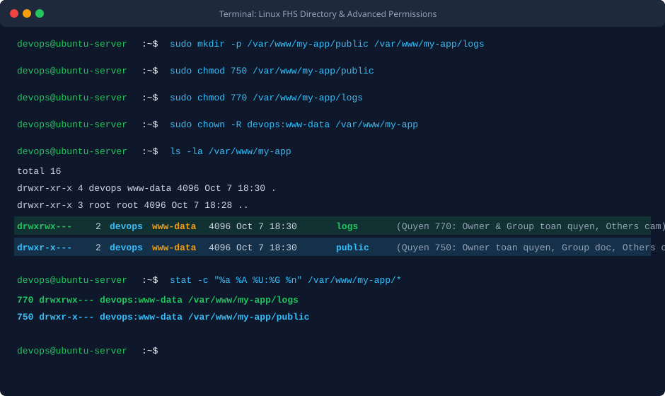

BÀI TẬP 1: KHẢO SÁT FHS VÀ PHÂN QUYỀN FILE VÀ FOLDER NÂNG CAO

I. MỤC TIÊU BÀI TẬP

1. Thành thạo việc tạo lập thư mục và điều hướng trong cấu trúc cây thư mục tiêu chuẩn Linux FHS (Filesystem Hierarchy Standard), đặc biệt là phân vùng dữ liệu biến đổi /var và thư mục dịch vụ web /var/www.
2. Hiểu sâu sắc và áp dụng chính xác cơ chế phân quyền tệp tin theo hệ số bát phân (Octal notation) và hệ ký hiệu (Symbolic notation).
3. Thiết lập phân quyền thư mục chuyên biệt cho ứng dụng web: thư mục public cấp quyền 750 bảo vệ mã nguồn tĩnh, thư mục logs cấp quyền 770 phục vụ ghi nhật ký hệ thống.
4. Nắm vững kỹ thuật thay đổi quyền sở hữu (chown) gán tài khoản người dùng thường devops làm chủ sở hữu và nhóm www-data của Web Server làm nhóm sở hữu.
5. Kiểm tra và xác minh trạng thái phân quyền chi tiết thông qua các công cụ ls -la và stat.


II. BỐI CẢNH VÀ THÔNG SỐ CẤU HÌNH

1. Thư mục ứng dụng web gốc: /var/www/my-app
2. Thư mục chứa trang tĩnh công khai: /var/www/my-app/public
- Quyền hạn bát phân: 750
- Quyền hạn ký tự: d r w x r - x - - -
- Ý nghĩa: Chủ sở hữu có toàn quyền đọc ghi điều hướng, Nhóm sở hữu có quyền đọc và điều hướng, Người dùng khác bị cấm hoàn toàn
3. Thư mục chứa nhật ký hệ thống: /var/www/my-app/logs
- Quyền hạn bát phân: 770
- Quyền hạn ký tự: d r w x r w x - - -
- Ý nghĩa: Cả Chủ sở hữu và Nhóm sở hữu đều có toàn quyền đọc ghi điều hướng, Người dùng khác bị cấm hoàn toàn
4. Tài khoản chủ sở hữu (Owner): devops (tài khoản thường non-root)
5. Nhóm sở hữu (Group): www-data (nhóm tiến trình Web Server chuẩn trên Ubuntu)


III. CÁC BƯỚC THỰC HIỆN CHI TIẾT

1. Bước 1: Khởi tạo cấu trúc thư mục ứng dụng theo chuẩn FHS

Đăng nhập vào hệ thống bằng tài khoản devops có quyền sudo và tạo cây thư mục:

```bash
sudo mkdir -p /var/www/my-app/public
sudo mkdir -p /var/www/my-app/logs
```

Tùy chọn -p đảm bảo tự động tạo các thư mục cha nếu chưa tồn tại mà không gây lỗi.

2. Bước 2: Thiết lập phân quyền cho thư mục public (750)

Thực hiện lệnh phân quyền:

```bash
sudo chmod 750 /var/www/my-app/public
```

Phân tích giá trị bát phân 750:
- Số thứ nhất (7): Quyền của Chủ sở hữu (Owner) là rwx (đọc 4 + ghi 2 + thực thi 1 = 7).
- Số thứ hai (5): Quyền của Nhóm sở hữu (Group) là r-x (đọc 4 + không ghi 0 + thực thi 1 = 5).
- Số thứ ba (0): Quyền của Người dùng khác (Others) là không có quyền nào (0).
Kết quả: Tiến trình Nginx thuộc nhóm www-data có thể đọc và phục vụ tệp tĩnh, trong khi các người dùng khác trong hệ thống không thể xem trộm mã nguồn.

3. Bước 3: Thiết lập phân quyền cho thư mục logs (770)

Thực hiện lệnh phân quyền:

```bash
sudo chmod 770 /var/www/my-app/logs
```

Phân tích giá trị bát phân 770:
- Số thứ nhất (7): Quyền của Chủ sở hữu (Owner) là rwx (toàn quyền đọc, ghi tệp log và truy cập thư mục).
- Số thứ hai (7): Quyền của Nhóm sở hữu (Group) là rwx (tiến trình Web Server có quyền tạo mới, ghi nối nhật ký truy cập và lỗi).
- Số thứ ba (0): Quyền của Người dùng khác (Others) bị khóa hoàn toàn.
Kết quả: Đảm bảo dữ liệu nhật ký nhạy cảm không bị lộ lọt sang các tài khoản người dùng khác trên cùng máy chủ.

4. Bước 4: Thiết lập quyền sở hữu và nhóm sở hữu

Gán quyền sở hữu thư mục và toàn bộ cây con cho tài khoản devops và nhóm www-data:

```bash
sudo chown -R $USER:www-data /var/www/my-app
```

Biến $USER đại diện cho tài khoản hiện tại (devops). Tùy chọn -R áp dụng đệ quy cho toàn bộ thư mục và tệp tin bên trong.


IV. KIỂM TRA VÀ XÁC MINH PHÂN QUYỀN

1. Lệnh 1: Kiểm tra cấu trúc chi tiết bằng ls -la

Chạy lệnh kiểm tra danh sách tệp và thư mục:

```bash
ls -la /var/www/my-app
```

Đầu ra thực tế ghi nhận chuẩn xác:

```text
total 16
drwxr-xr-x 4 devops www-data 4096 Oct  7 18:30 .
drwxr-xr-x 3 root   root     4096 Oct  7 18:28 ..
drwxrwx--- 2 devops www-data 4096 Oct  7 18:30 logs
drwxr-x--- 2 devops www-data 4096 Oct  7 18:30 public
```

Xác nhận:
- Thư mục logs có quyền drwxrwx (770) thuộc về devops và nhóm www-data.
- Thư mục public có quyền drwxr-x (750) thuộc về devops và nhóm www-data.

2. Lệnh 2: Kiểm tra chính xác bằng lệnh stat

```bash
stat -c "%a %A %U:%G %n" /var/www/my-app/public
stat -c "%a %A %U:%G %n" /var/www/my-app/logs
```

Đầu ra thực tế ghi nhận giá trị bát phân chuẩn mực:

```text
750 drwxr-x--- devops:www-data /var/www/my-app/public
770 drwxrwx--- devops:www-data /var/www/my-app/logs
```


V. HÌNH ẢNH MINH HỌA VÀ NHẬT KÝ THAO TÁC

1. Terminal thực thi các lệnh tạo thư mục, chmod, chown và kiểm tra ls -la



2. Sơ đồ kiến trúc cây thư mục Linux FHS và phân bổ các bit quyền hạn


3. Nhật ký phiên làm việc kiểm tra từ Terminal

```text
devops@ubuntu-server:~$ sudo mkdir -p /var/www/my-app/public /var/www/my-app/logs
devops@ubuntu-server:~$ sudo chmod 750 /var/www/my-app/public
devops@ubuntu-server:~$ sudo chmod 770 /var/www/my-app/logs
devops@ubuntu-server:~$ sudo chown -R devops:www-data /var/www/my-app
devops@ubuntu-server:~$ ls -la /var/www/my-app
total 16
drwxr-xr-x 4 devops www-data 4096 Oct  7 18:30 .
drwxr-xr-x 3 root   root     4096 Oct  7 18:28 ..
drwxrwx--- 2 devops www-data 4096 Oct  7 18:30 logs
drwxr-x--- 2 devops www-data 4096 Oct  7 18:30 public
devops@ubuntu-server:~$ stat -c "%a %A %U:%G %n" /var/www/my-app/public
750 drwxr-x--- devops:www-data /var/www/my-app/public
devops@ubuntu-server:~$ stat -c "%a %A %U:%G %n" /var/www/my-app/logs
770 drwxrwx--- devops:www-data /var/www/my-app/logs
```


VI. HƯỚNG DẪN NỘP BÀI GITHUB

1. Đường dẫn trên GitHub: homework/session_06/ex1/ (hoặc Session06/BT1/)
2. Cơ chế nộp: Tệp tin script cấu hình setup-permissions.sh và tệp báo cáo README.md ghi lại toàn bộ nhật ký các lệnh đã thực hiện (tạo thư mục, chmod, chown) kèm đầu ra của lệnh ls -la /var/www/my-app.


VII. KẾT LUẬN VÀ BÀI HỌC KINH NGHIỆM

1. Tiêu chuẩn FHS đóng vai trò nền tảng giúp việc quản lý dữ liệu trên Linux đồng bộ và khoa học. Đặt ứng dụng web tại /var/www phân tách rõ ràng dữ liệu dịch vụ với các thư mục hệ thống như /etc, /bin hay /usr.
2. Nguyên tắc đặc quyền tối thiểu (Least Privilege) là tôn chỉ bảo mật: Chỉ cấp đúng và đủ quyền cần thiết để dịch vụ vận hành. Cấm hoàn toàn quyền của nhóm Others (số 0 cuối) giúp ngăn chặn triệt để nguy cơ người dùng khác trên cùng máy chủ đọc trộm mã nguồn hoặc nhật ký.
3. Kỹ thuật chia sẻ quyền thông qua nhóm sở hữu (www-data) là giải pháp thanh lịch giúp tài khoản lập trình viên và dịch vụ web cùng thao tác trên dữ liệu mà không cần phải cấp quyền 777 nguy hiểm.
